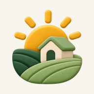
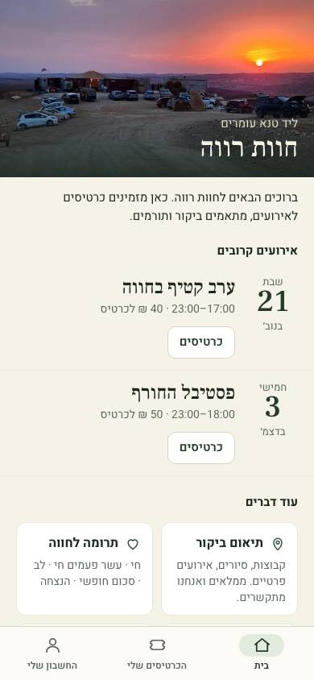
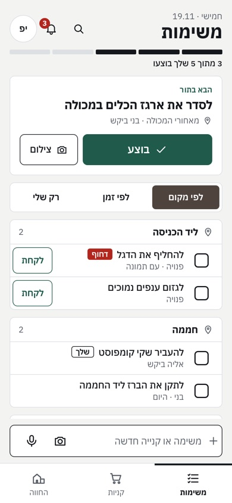
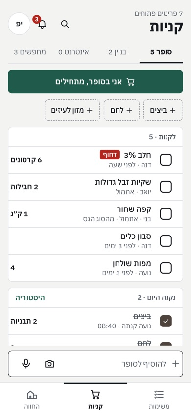
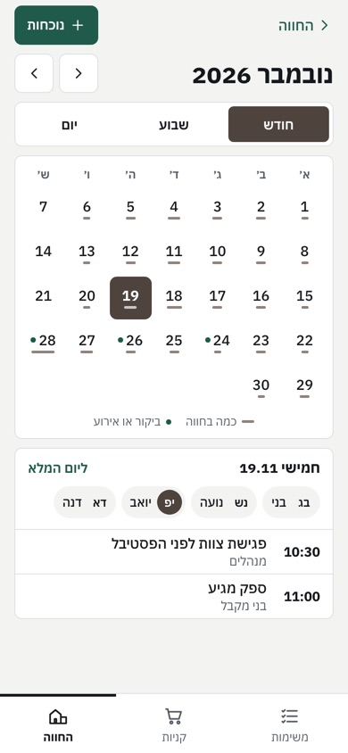
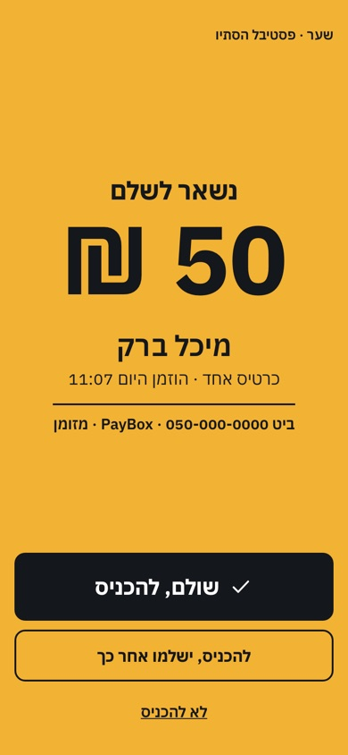
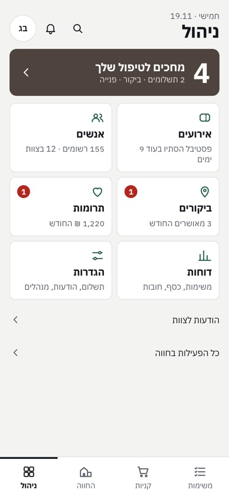
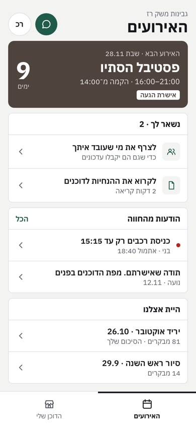
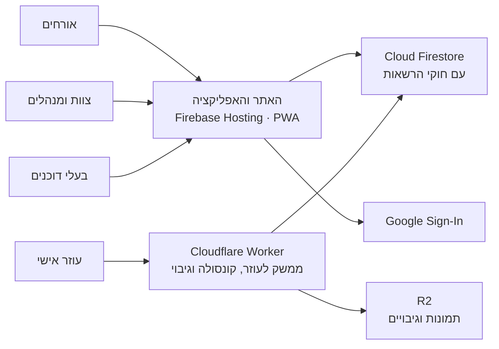

<p align="center">
  
</p>

<h1 align="center">חוות רווה</h1>

<p align="center">
  האתר והאפליקציה של חוות רווה: אורחים מזמינים כרטיסים ותורמים, הצוות מנהל את העבודה היומיומית, ובערב אירוע כל השער, הדוכנים והקופה רצים מהטלפון.
</p>

<p align="center">
  <a href="https://havat-ravve.web.app">האתר</a> ·
  <a href="https://havat-ravve.web.app/app">האפליקציה</a> ·
  <a href="https://havat-ravve.web.app/app?demo=owner">לנסות בלי חשבון</a>
</p>

---

חוות רווה נמצאת ליד טנא עומרים ומחסום מיתר. מגיעים אליה לאירועים ולפסטיבלים, לביקורים בתיאום מראש ולהתנדבות. מה שהתחיל כלוח משימות פשוט הפך לאפליקציה אחת שמחזיקה את כל החווה: את מי שבא לבקר, את מי שעובד בה, ואת מי שמוכר בה ביום האירוע.

הכל בעברית, מימין לשמאל, נבנה קודם כל לטלפון, ועובד גם כשאין קליטה בשטח.

<table>
  <tr>
    <td align="center"><br><sub>אורחים: אירועים קרובים</sub></td>
    <td align="center"><br><sub>צוות: משימות לפי מקום</sub></td>
    <td align="center"><br><sub>צוות: רשימת קניות</sub></td>
    <td align="center"><br><sub>מי בחווה: יומן חודשי</sub></td>
  </tr>
  <tr>
    <td align="center"><br><sub>ערב אירוע: תשלום בשער</sub></td>
    <td align="center"><br><sub>מנהלים: מה מחכה לטיפול</sub></td>
    <td align="center"><br><sub>בעלי דוכנים: האירוע הבא</sub></td>
  </tr>
</table>

<sub>הצילומים ממצב ההדגמה: השמות, הטלפונים והסכומים בדויים.</sub>

## מה אפשר לעשות בה

### לאורחים
- לראות את האירועים הקרובים גם בלי להתחבר, ולהזמין כרטיסים עם חשבון Google. כל כרטיס מקבל QR משלו, והכרטיסים נפתחים גם בלי קליטה.
- לשלם בביט או ב־PayBox, ולסמן "העברתי" כדי שהחווה תאשר.
- לתאם ביקור לקבוצה, לסיור או לאירוע פרטי.
- לתרום לחווה, עם הקדשה וקבלה אם רוצים.
- לראות את החשבון הפתוח בדוכן, את הכרטיסים והתרומות, ולפנות לחווה.

### לצוות ולמתנדבים
- **משימות** לפי מקום, לפי זמן או רק שלי. לוקחים משימה, מסמנים שבוצעה, מצלמים מהשטח. משימות חוזרות נוצרות לבד.
- **קניות** בקטגוריות, עם הצעות ממה שנקנה בעבר ומצב "יוצאים לקנות" שמסמן תוך כדי הליכה בחנות. מחליקים שורה הצידה כדי לסמן שנקנה או למחוק.
- **החווה**: יומן "מי בחווה" לפי חודש, שבוע או יום, נוכחות, מקומות בחווה, ועדכונים מהצוות.
- **פרויקטים** לבעלים: מטרה, צעדים ותאריך יעד, למשל "מערכת השקיה חדשה".
- **הודעות לצוות** עם אישור קריאה, והתראות לטלפון.

### בערב אירוע
- **שער**: סריקת QR או חיפוש לפי שם. רואים מיד אם הכרטיס תקין, אם נשאר לשלם, ואם כבר נכנסו איתו. אפשר "שולם, להכניס" או "ישלמו אחר כך". שני שערים לא יכולים להכניס את אותו כרטיס פעמיים, גם כשאחד מהם בלי קליטה.
- **אורח בלי כרטיס** מקבל כרטיסים בשער, והוא כבר בפנים.
- **דוכן**: מכירה לאורח לחשבון פתוח, וסגירה בסוף הערב.
- **תמונה חיה**: כמה נכנסו, כמה שילמו בשער, מי עוד חייב, ונתונים לפי שעה.
- **סגירת אירוע** עם ספירת קופה וסיכום.

### למנהלים
- מסך אחד שמראה מה מחכה לטיפול: תשלומים לאישור, בקשות ביקור ופניות.
- אירועים מקצה לקצה: פרטים, נרשמים, שיבוץ צוות, קבצים, מוצרי הדוכן, חובות ודוח סיכום.
- אנשים ותפקידים. מגדירים מראש מייל ותפקיד, ומי שנכנס עם הכתובת הזו מקבל את התפקיד. אין קודים ואין תור אישורים.
- ביקורים, תרומות וקבלות, דוחות, והגדרות: פרטי תשלום, סכומי תרומה, סוגי ביקור, שאלות הרשמה והודעות מוכנות.
- **היסטוריה לכל דבר**: כל פעולה נרשמת (מי, מה, מתי) ומוצגת בכל פריט, אצל כל אדם ובמסך "כל הפעילות בחווה".

### לבעלי דוכנים
- מקבלים קישור בוואטסאפ ונכנסים עם Google, בלי סיסמה.
- מאשרים הגעה לאירוע, קוראים את ההנחיות, מצרפים עוזרים, ופותחים בקשה ביום האירוע (חשמל, מים, עזרה).

### לבעלים
- **עריכת האתר** (`/edit`): טקסטים, תמונות ואירועים, עם תצוגה מקדימה חיה, טיוטה ופרסום.
- **קונסולת השרת** (`/admin`): מצב השרת, מפתחות גישה, אנשים, גיבוי לילי וסל מחזור.
- **API לעוזר אישי**: Cloudflare Worker שמאפשר לעוזר לקרוא ולכתוב משימות, קניות, אירועים ועוד, בשם אדם אמיתי ועם אותן הרשאות. כל בקשה נרשמת ביומן. פירוט ב־[`api/README.md`](api/README.md).

## איך היא בנויה



- **רק מסלולים חינמיים.** Firebase במסלול Spark (בלי Cloud Functions ובלי חיוב), ו־Cloudflare Workers במסלול החינמי.
- **ההרשאות נאכפות בשרת.** כל קריאה וכתיבה עוברות דרך [`firestore.rules`](firestore.rules), והתפקיד נקבע לפי חשבון Google בלבד.
- **עובד בלי קליטה.** הנתונים נשמרים בטלפון ונשלחים כשהרשת חוזרת. בשער, פעולה שלא נענתה תוך כמה שניות נשמרת בטלפון ולא הולכת לאיבוד.
- **מצב הדגמה הוא ארגז חול.** כל אחד יכול לעבור באפליקציה בתור בעלים, מנהל, מתנדב, בעל דוכן או אורח, עם נתונים בדויים. במצב הזה שום דבר לא נקרא מהשרת ושום דבר לא נכתב אליו. בכניסה הראשונה האפליקציה נפתחת בהדגמה ברמת ההרשאה של המשתמש.
- **אפשר להתקין** כאפליקציה מהדפדפן (PWA), ויש גם עטיפת Android בתיקייה [`android/`](android).

## מבנה התיקיות

| תיקייה | מה יש בה |
|---|---|
| `src/app/v2/` | האפליקציה (React): מסכים לפי תחום ב־`screens/`, רכיבים משותפים ב־`kit/`, שכבת הנתונים ב־`data/` |
| `src/app/demo/` | נתוני ההדגמה והדמויות |
| `src/console/` | קונסולת הבעלים (`/admin`) |
| `src/Admin.tsx`, `src/cms.ts` | עורך האתר (`/edit`) |
| `api/` | ה־Worker: ה־API, הקונסולה בצד השרת והגיבוי |
| `firestore.rules` | ההרשאות |
| `tests/` | בדיקות הליבה, ההדגמה, ההרשאות וה־API |
| `docs/` | אפיון, עיצוב, בדיקות חזותיות ומסמכי תפעול |
| `dist/` | האתר הבנוי. נשמר בריפו, וה־CI בודק שהוא תואם לקוד |

## פיתוח מקומי

צריך Node.js 22 ומעלה, ו־Java לאמולטורים של Firebase (למשל `brew install openjdk`).

```bash
npm ci
```

```bash
npm run dev
```

אחר כך פותחים http://localhost:5050/app?emulator. האפליקציה מתחברת לאמולטורים ולא לפרויקט האמיתי.

לתצוגה מהירה בלי אמולטורים, רק במצב הדגמה:

```bash
node scripts/dev.mjs
```

ופותחים http://localhost:5173/app?demo=owner. דמויות אחרות: `manager`, `staff`, `guest`, `anon`, `new`.

### בדיקות

```bash
npm test
```

```bash
npm run test:rules
```

```bash
npm run test:api
```

כל הבדיקות רצות מול אמולטורים ופרויקט דמה, ולא נוגעות במסד האמיתי.

## פריסה

כל מיזוג ל־`main` נפרס לייצור אוטומטית (Hosting, חוקי Firestore ואינדקסים). כל Pull Request מקבל ערוץ תצוגה מקדימה משלו לשבוע. ה־Worker נפרס בנפרד עם `wrangler`.

ההוראות המלאות להגדרת ה־CI, לפריסה מהמחשב, להעברת תוכן מהאתר הישן, לעריכת האתר ולמגבלות של המסלול החינמי נמצאות ב־[`docs/operations.md`](docs/operations.md).

## מסמכים

- [`docs/spec.md`](docs/spec.md): האפיון המלא
- [`docs/redesign-progress.md`](docs/redesign-progress.md): העיצוב החדש, מסך אחרי מסך
- [`docs/demo-coverage.md`](docs/demo-coverage.md): איך מגיעים לכל מסך במצב הדגמה
- [`docs/operations.md`](docs/operations.md): תפעול, פריסה והגדרות
- [`api/README.md`](api/README.md): ה־API

---

<details>
<summary>In English</summary>

**Havat Ravve** is a farm near Tene Omarim in southern Israel. This repository holds its public website and its Hebrew, right-to-left, mobile-first app:

- **Guests** browse events, order tickets (one QR per ticket, works offline), donate, and request visits.
- **The team** shares tasks, a shopping list, a farm calendar, projects, and team messages.
- **On event nights** the app runs the gate (QR scan, pay at the gate, walk-ins), the stall's open tabs, live counters, and the closing cash count.
- **Managers** handle events, people and roles, visits, donations, reports, and settings. Every action is kept in a history.
- **Stall vendors** get a WhatsApp link, sign in with Google, confirm attendance, and add helpers.
- **Owners** get a site editor, a server console, and an API that lets a personal assistant act through a Cloudflare Worker.

It runs entirely on free tiers: Firebase Hosting, Auth and Firestore on Spark, plus Cloudflare Workers Free. Access is enforced by Firestore security rules. A full demo mode works with no account and never touches the server: [try it](https://havat-ravve.web.app/app?demo=owner).

</details>
